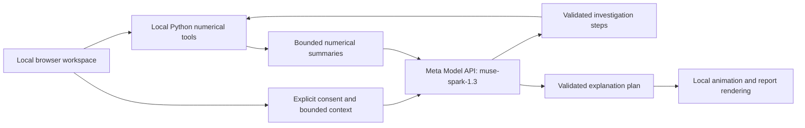

# SignalTrace

**See how preprocessing choices change the biosignal measurements your research depends on.**

SignalTrace is a local research workspace that turns a recording and a research question into an inspectable investigation. Meta chooses bounded analysis steps, local numerical tools measure their effects, and the investigation produces a detailed report. A separately consented Meta explanation turns validated evidence into animated findings.

**Created by Yeon Jun Kim — solo creator and contributor.**

[Project overview video](https://youtu.be/tbP4VcBEKi8) · [Architecture details](docs/ARCHITECTURE.md) · [Data policy](docs/DATA_POLICY.md)
## Why this exists

A preprocessing choice can change detected candidate peaks, their timing and their count. A cleaner-looking trace alone does not establish whether those changes are acceptable for the measurement an experiment needs.

SignalTrace makes those consequences visible. Its first implemented analysis module is **PPG preprocessing sensitivity**: inspect the original recording, compare settings over the same window, review support exclusions and trace conclusions back to measured evidence. Other waveforms can use generic recording inspection; ECG, EEG and other modality-specific analysis are not implemented.

The numerical foundations use established signal-processing methods and Python scientific libraries for filtering, candidate detection and deterministic comparison. The hackathon contribution combines these foundations into a research-question-driven Meta investigation with feedback from measurement checks, evidence-linked decisions, and a separate Meta-directed animated explanation. Existing numerical methods are not presented as newly invented algorithms.

## Architecture

A local FastAPI server serves the browser workspace and runs Python analysis jobs.



| Path | Model and hosting | Meaningful work |
| --- | --- | --- |
| Investigation | `muse-spark-1.3`, remotely hosted through Meta Model API | Selects allowed tools and settings, reviews numerical feedback, proposes bounded follow-ups and evidence-linked conclusions. |
| Explanation, with separate consent | `muse-spark-1.3`, remotely hosted through Meta Model API | Selects evidence, scenes and interpretation for an animated findings video; the application validates the plan. |

**All live AI inference calls in the shipped application use Meta**, through the fixed endpoint `https://api.meta.ai/v1/responses`. Python numerical computation, the UI, plot geometry, rendering and replay run locally. Browser requests to the local application API are not model calls. Mocked tests and playback make no provider calls.

Raw waveform arrays stay local. Consented requests send reviewed research context and bounded numerical summaries. Free-text context can contain identifying information if you enter it; review it before sending.

For example, a waveform-change check can fail at one cutoff. Meta can choose a lower cutoff, rerun the allowed tools and inspect the returned check. The next result can still fail. That feedback loop supports an honest investigation; it does not establish physiological accuracy, a universally best filter or superiority over deterministic baselines.

## Run from a fresh clone

Install Python 3.11 or later and Git. Windows PowerShell:

```powershell
git clone https://github.com/calavera16/SignalChase.git
cd SignalChase
py -m venv .venv
.\.venv\Scripts\python.exe -m pip install -r requirements.txt
.\.venv\Scripts\python.exe -m uvicorn signaltrace.server:app --host 127.0.0.1 --port 8767 --no-access-log
```

If Windows does not provide `py`, use `python -m venv .venv` for the environment-creation step. No activation or execution-policy change is needed.

macOS / Linux:

```sh
git clone https://github.com/calavera16/SignalChase.git
cd SignalChase
python3 -m venv .venv
./.venv/bin/python -m pip install -r requirements.txt
./.venv/bin/python -m uvicorn signaltrace.server:app --host 127.0.0.1 --port 8767 --no-access-log
```

Open `http://127.0.0.1:8767`. Keep this single-user server bound to loopback. No frontend build is required.

### Five-step judge walkthrough

1. Choose **Continue offline** at first use, then **Try sample recording** for a synthetic recording. Local analysis needs no key, downloaded dataset or model request.
2. Enter the research setup and choose **Save setup & continue to Inspect**. Inspect the original trace and recording issues.
3. Compare preprocessing settings and inspect measured changes. For a live investigation, use **Set up Meta key**, enter your own key in the masked field, review the context and consent, then choose **Investigate with Meta**.
4. Review the returned evidence and any follow-up comparisons. Distinguish measured changes from what the evidence cannot establish.
5. With separate explanation consent, choose **Create findings video with Meta**. Watch **Animated findings**, then open **Detailed report and evidence** to inspect the supporting measurements.

Saving a key does not make a model request. A browser-entered key stays only in server process memory, not browser storage or a credential file; restarting clears it. **Clear key and use offline** also disables environment-key fallback until restart. Each investigation and explanation requires explicit consent. Live use requires Meta account access to the model and is subject to Meta availability, terms and charges. See [Security](SECURITY.md).

## Reproducibility, data and development

The public tree contains source and small authored fixtures, with synthetic signals generated at runtime. Full raw recordings, private live evaluation bundles and local results are omitted. Optional [BIDMC](https://physionet.org/content/bidmc/1.0.0/) data must be downloaded manually under its applicable terms; see [Data policy](docs/DATA_POLICY.md).

Generate an offline synthetic experiment without a key:

```powershell
# Windows PowerShell
.\.venv\Scripts\python.exe -m signaltrace --synthetic-only --output outputs/synthetic-check
```

```sh
# macOS / Linux
./.venv/bin/python -m signaltrace --synthetic-only --output outputs/synthetic-check
```

Run Python checks with `.\.venv\Scripts\python.exe -m pytest -q` on Windows or `./.venv/bin/python -m pytest -q` on macOS/Linux. Optional frontend checks use `npm ci` and `npm test`; locked dependencies require Node `^22.22.2 || ^24.15.0 || >=26.0.0`. Tests use synthetic inputs and mock transports; the downloaded-data check skips when absent.

Using the same virtual-environment Python executable, the clean-copy gate runs `scripts/build_public_repo.py --public-layout --output ../SignalTrace-clean-copy`, then `scripts/audit_public_repo.py ../SignalTrace-clean-copy`. It uses an allowlist and refuses to overwrite an existing target. See [Contributing](CONTRIBUTING.md).

OpenAI Codex assisted development. The existing overview film uses Edge neural speech narration. These development/media tools are separate from the application's Meta runtime inference.

Research software, not a clinical device or diagnostic service. Source is [MIT licensed](LICENSE); external datasets and media have separate rights. See [third-party notices](THIRD_PARTY_NOTICES.md).
